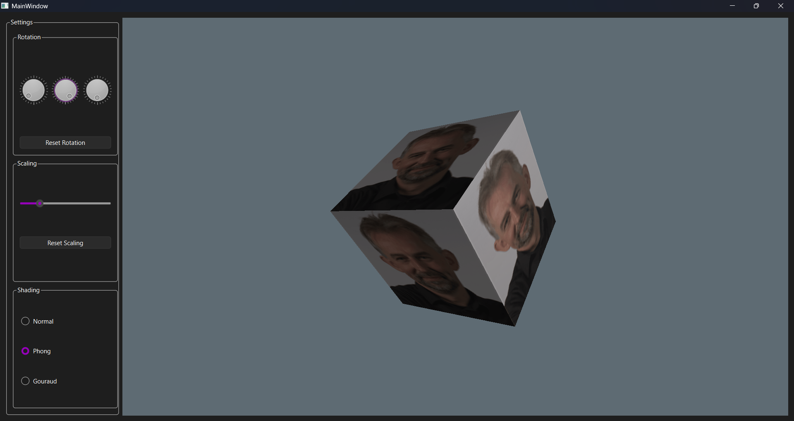

Example:

How to run on windows:

cmake -S src -B build -DCMAKE_PREFIX_PATH="C:\Qt\6.11.2\mingw_64" -DCMAKE_CXX_COMPILER="C:\Qt\Tools\mingw1310_64\bin\g++.exe" -DCMAKE_MAKE_PROGRAM="C:\msys64\mingw64\bin\mingw32-make.exe"
cmake --build build

.\build\OpenGL_2.exe